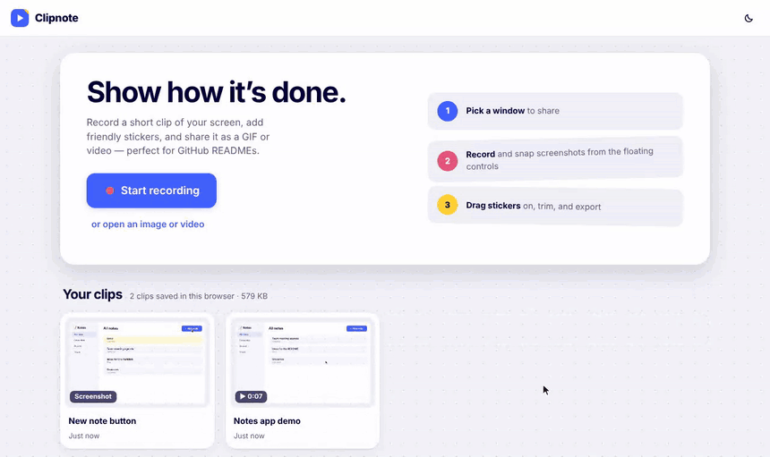

# Clipnote

Record a short clip of your screen, drop friendly animated stickers on it, and share it as a GIF, MP4 or PNG — made for quick how-to snippets in GitHub READMEs. Everything runs in the web page; nothing is uploaded.

### [▶ Try Clipnote live](https://jussikauhanen.github.io/vhs/)

Works best in Chrome or Edge on a computer.

<!-- Demo slots: replace any file in docs/ with a new one of the same name to update the pictures below. -->

## Use it

Open the [live version](https://jussikauhanen.github.io/vhs/), or open `index.html` from this folder in Chrome or Edge. (`Start Clipnote.command` is an optional Mac shortcut that serves the folder locally and opens it.)

1. Click **Start recording** and pick a window to share. That window comes to the front so you can work in it right away. Sharing a single window, not the entire screen, keeps the floating controls out of your video.
2. A small floating window stays on top of everything. It shows a live mini view of what is being recorded (blue frame when ready, red while recording) with **Record**, **Pause**, **Stop**, and the **camera** button for screenshots. Screenshots are collected and open as their own tabs when you finish. Press **Done** (or Stop) to finish.
3. In the editor, pick stickers from the panel on the left (search it, or browse the sections) and drag them onto your clip, or click one to add it in the middle:
   notes and tags, speech bubbles (speech, oval, thought, burst, box), arrows, highlight shapes (circle, box, highlighter, spotlight), mouse clicks (click, double-click, right-click) and keyboard keys (type something like `⌘ + Shift + P`).
   Each sticker pops in with a short animation and gets its own line in the timeline. Drag the line to choose when it shows, or drag its ends to make it shorter or longer. Click a sticker to move it, resize it from the round handle, change its text or colour, or delete it.
4. Trim the clip: drag the yellow handles, or move the playhead and press **Start here** / **End here**. Cut parts stay visible, hatched, so you can always drag them back. **Crop** trims the edges of the picture.
5. Click **Export** and choose **GIF**, **MP4** or **PNG**. Each quality option shows a zoomed-in sample of the actual result and an estimated file size. Drag the file into a GitHub README, issue or pull request.

**Your clips:** every recording, screenshot and opened file is saved automatically in this browser, stickers and edits included. A "Saved" mark at the top shows it is safe. Click the Clipnote logo or **Home** to see all your clips; click one to keep editing, click its name to rename it, or delete it (with Undo). Double-click a tab at the top to rename the open clip. Nothing is uploaded; clearing the browser's site data removes the clips, so export anything you want to keep for good.

Shortcuts in the editor: Space play/pause · ← → step (Shift: 1 s) · `[` `]` trim at the playhead · Delete removes the selected sticker · Esc deselects · ⌘Z undo · ⇧⌘Z redo.

## Good to know

- Recordings are silent and stop after 60 seconds.
- The floating controls need Chrome or Edge. In other browsers the controls stay in the Clipnote tab.
- MP4 export uses the browser's built-in video encoder (Chrome, Edge, Safari). GIF and PNG work everywhere.
- Clips are kept in this browser only (Chrome and Edge keep them even when you open `index.html` straight from the folder). Another browser or computer won't see them.

## Host on GitHub Pages

Put `index.html`, `style.css`, `app.js` and the `vendor` folder at the root of the publishing branch (the `docs` folder only holds the README pictures), then choose **Settings → Pages → Deploy from a branch**. The site appears at `https://jussikauhanen.github.io/<repository-name>/`; the links above assume the repository is called `clipnote`.

## Credits

- [gifenc](https://github.com/mattdesl/gifenc) 1.0.3 by Matt DesLauriers, MIT license (`vendor/gifenc-LICENSE.md`).
- [mp4-muxer](https://github.com/Vanilagy/mp4-muxer) 5.2.2 by Vanilagy, MIT license (`vendor/mp4-muxer-LICENSE.md`).
